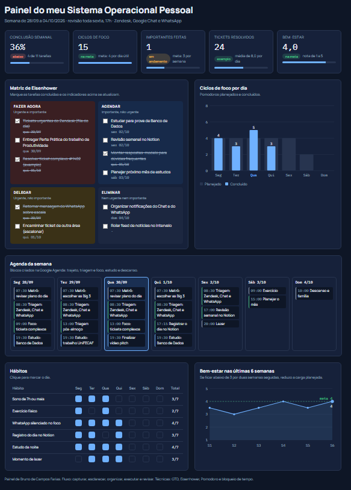
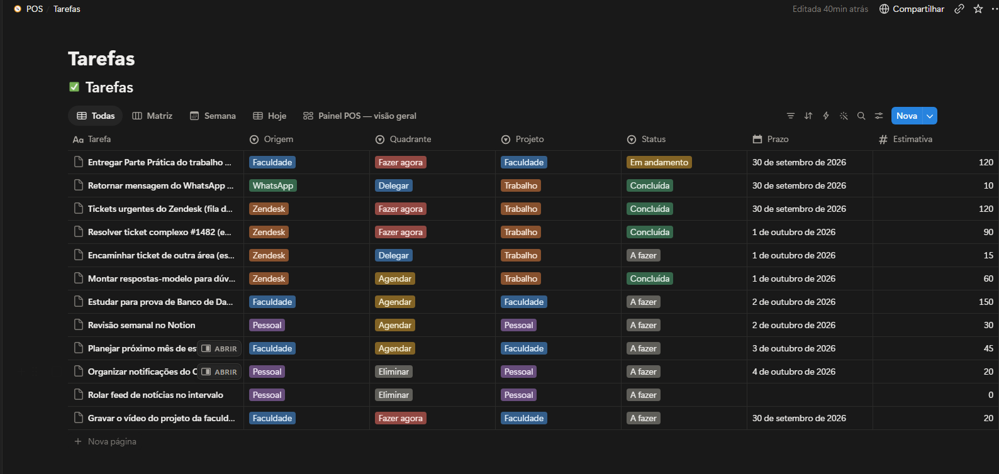
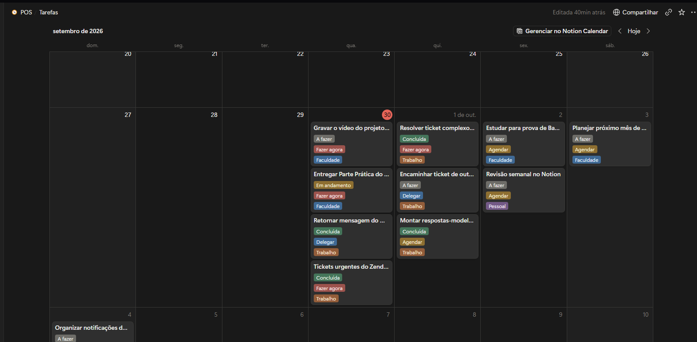
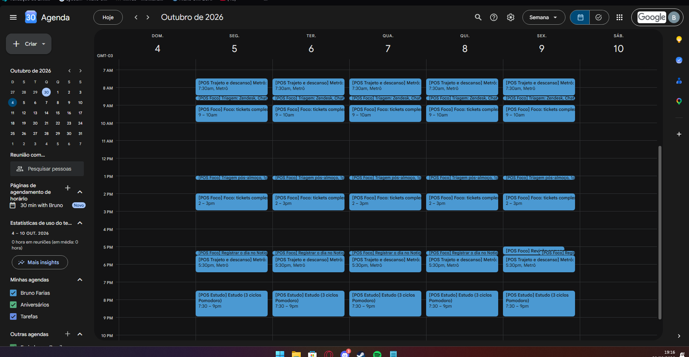

# Meu Sistema Operacional Pessoal (POS)

Sistema pessoal de organização que combina métodos de produtividade, ferramentas digitais e Inteligência Artificial para gerenciar tempo, comunicação e bem-estar.

Projeto da disciplina **Produtividade e Gestão do Tempo** (UniFECAF).
Aluno: **Bruno de Campos Farias**

🌐 **[Abrir o painel interativo](https://brunocfarias.github.io/sistema-produtividade-pessoal/dashboard.html)**: clique nas tarefas e nos hábitos para ver os indicadores mudarem.

## 1. Descrição do sistema

Trabalho em um escritório resolvendo tickets no Zendesk e fazendo atendimentos conforme eles aparecem, me comunico pelo Google Chat e pelo WhatsApp, faço o trajeto de metrô (cerca de 1 hora de ida e 1 hora de volta) e uso a noite para estudar. O problema: as demandas chegam por três canais ao mesmo tempo, o dia é reativo e sobra pouca energia para estudar.

O POS resolve isso com um ciclo semanal de cinco passos:

1. **Capturar**: toda demanda que não é resolvida na hora entra em uma Caixa de Entrada única (Notion).
2. **Esclarecer**: a IA transforma anotações soltas em tarefas com próxima ação, estimativa e prazo.
3. **Organizar**: cada tarefa recebe um quadrante da Matriz de Eisenhower, uma origem (Zendesk, Faculdade, WhatsApp ou Pessoal) e um projeto.
4. **Executar**: as tarefas viram blocos na Google Agenda, feitos em ciclos Pomodoro.
5. **Revisar**: toda sexta, o painel mostra os números da semana e a IA sugere ajustes.

O Zendesk continua sendo o lugar onde os tickets são resolvidos. No Notion registro apenas o que precisa de acompanhamento, o que é estudo e os números do dia.

O sistema cobre o que o enunciado pede: organização de tarefas e prioridades, planejamento semanal, gestão de compromissos, técnicas de produtividade, ferramenta digital, uso de IA e painel de acompanhamento da produtividade.

## 2. Ferramentas utilizadas

| Ferramenta | Para que serve |
|---|---|
| Notion | Central do sistema: caixa de entrada, banco de tarefas, registro diário e planejamento semanal. |
| Google Agenda | Blocos de triagem, foco, estudo, trajeto e descanso, com lembretes. |
| Claude (IA) | Triagem, planejamento semanal, quebra de tarefas, rascunho de respostas, mensagens e análise da semana. |
| Painel HTML (`dashboard.html`) | Dashboard interativo de acompanhamento da produtividade. |
| Zendesk, Google Chat e WhatsApp | Canais de entrada já usados no trabalho. O POS organiza o que chega por eles. |

**Técnicas aplicadas:** GTD, Matriz de Eisenhower, Pomodoro (25/5), bloqueio de tempo e regra dos 2 minutos.

## 3. Fluxo de organização

```
Entradas: Zendesk, Google Chat, WhatsApp, ideias no metrô
        │
        ▼
Captura (Caixa de Entrada no Notion)   ← o que se resolve em 2 minutos é feito na hora
        │
        ▼
Triagem com IA ──► tarefa + próxima ação + estimativa + prazo
        │
        ▼
Eisenhower ──► Fazer agora | Agendar | Delegar | Eliminar
        │
        ▼
Planejamento semanal (IA propõe blocos) ──► Google Agenda
        │
        ▼
Execução em Pomodoros (WhatsApp silenciado, status "em foco" no Chat)
        │
        ▼
Registro diário no Notion ──► números da semana no painel
        │
        ▼
Revisão de sexta ──► painel + análise da IA ──► ajustes para a próxima semana
```

**Um dia típico**

| Horário | Bloco | O que faço |
|---|---|---|
| 7h30 às 8h30 | Metrô (ida) | Revisar o plano do dia e escolher as 3 prioridades (Big 3). |
| 8h30 às 8h45 | Triagem | Olhar Zendesk, Chat e WhatsApp e classificar por urgência. |
| Durante a manhã | Foco e atendimentos | Tickets urgentes primeiro; tickets complexos em ciclos de 25 minutos. |
| 11h30 às 13h | Almoço | Pausa real, longe da tela. |
| 13h às 13h15 | Triagem pós-almoço | Reordenar a fila com o que chegou. |
| Tarde | Foco e atendimentos | Mesma lógica da manhã. |
| 17h15 às 17h30 | Fechamento | Registrar tickets resolvidos, ciclos e pendências no Notion. |
| 17h30 às 18h30 | Metrô (volta) | Atividade leve: ouvir ou ler um conteúdo de estudo. |
| Noite | Estudo | 3 ciclos Pomodoro na tarefa da faculdade, com horário para parar. |

**Revisão semanal (sexta, 30 minutos):** atualizar o painel com os números do Registro diário, pedir a análise da IA (prompt 6) e planejar a semana seguinte (prompt 2).

**Comunicação:** verificação do Zendesk, do Chat e do WhatsApp em horários definidos, mantendo atenção constante apenas aos tickets urgentes. Mensagens no formato contexto, pedido e prazo (prompt 5).

**Saúde mental:** pausas reais, WhatsApp silenciado no foco, horário para encerrar o estudo e proteger o sono, hábitos monitorados e nota de bem-estar semanal. Se a nota ficar abaixo de 3 por duas semanas, reduzo a carga planejada.

## 4. Prints

**Painel de acompanhamento (computador)**



**Banco de tarefas no Notion**



**Planejamento semanal no Notion**



**Blocos na Google Agenda**



## 5. Como utilizar a solução

### 5.1 Montar a Google Agenda (cerca de 15 minutos)

1. Em **Outras agendas > Criar nova agenda**, crie três agendas: **POS Foco** (verde), **POS Estudo** (azul) e **POS Trajeto e descanso** (cinza). Assim dá para ligar e desligar cada tipo.
2. Crie estes eventos, repetindo de segunda a sexta (**Repetir: todos os dias úteis**):

   | Evento | Horário | Agenda |
   |---|---|---|
   | Metrô: revisar plano do dia | 7h30 às 8h30 | POS Trajeto e descanso |
   | Triagem: Zendesk, Chat e WhatsApp | 8h30 às 8h45 | POS Foco |
   | Foco: tickets complexos | 9h às 10h | POS Foco |
   | Triagem pós-almoço | 13h às 13h15 | POS Foco |
   | Foco: tickets complexos | 14h às 15h | POS Foco |
   | Registrar o dia no Notion | 17h15 às 17h30 | POS Foco |
   | Metrô: conteúdo leve | 17h30 às 18h30 | POS Trajeto e descanso |
   | Estudo (3 ciclos Pomodoro) | 19h30 às 21h | POS Estudo |

3. Crie o evento semanal **Revisão semanal** na sexta, das 17h às 17h30, e ative a notificação 10 minutos antes.
4. Nos blocos de foco, use o status **Ocupado** e, no Google Chat, deixe o status como "em foco". Os blocos são janelas protegidas: um ticket urgente ainda pode interrompê-las.
5. Acrescente os compromissos pontuais (reuniões, provas) na agenda normal.

### 5.2 Montar o Notion (cerca de 20 minutos)

1. Crie uma página chamada **POS**.
2. Dentro dela, crie o banco de dados **Tarefas** e importe o arquivo `pos_tarefas.csv` (menu ••• do banco, **Merge with CSV**). Ajuste as propriedades: *Origem*, *Quadrante*, *Projeto* e *Status* como Seleção; *Prazo* como Data; *Estimativa* e *Pomodoros* como Número.
3. Crie estas visualizações do banco Tarefas: **Matriz** (quadro agrupado por Quadrante), **Semana** (calendário por Prazo) e **Hoje** (filtro: Prazo é hoje e Status diferente de Concluída).
4. Crie o banco **Registro diário** e importe `pos_registro_diario.csv`. Nele você anota, uma vez por dia: tickets resolvidos, ciclos de foco, hábitos e nota de bem-estar. Use a visualização em tabela.
5. Crie a página **Caixa de Entrada** com uma lista simples para capturar tudo o que não foi resolvido na hora.

Os gráficos ficam no painel HTML (seção 5.4), que mostra os indicadores, a matriz, os ciclos de foco, os tickets, os hábitos e o bem-estar. O Notion guarda os dados; o painel mostra o resultado.

Não copie todos os tickets do Zendesk para o Notion. Registre só os que precisam de acompanhamento e o total resolvido no dia.

### 5.3 Usar no dia a dia

1. No metrô da manhã, abra a visualização **Hoje** no Notion e escolha as 3 prioridades.
2. Tudo o que chegar e não for resolvido em 2 minutos vai para a Caixa de Entrada.
3. Uma vez por dia, cole as anotações no **prompt 1** (`prompts_ia.md`) e copie a tabela resultante para o banco Tarefas.
4. Para respostas de tickets mais difíceis, use o **prompt 7**, sempre sem dados pessoais do cliente.
5. Às 17h15, registre o dia no banco Registro diário (o **prompt 8** ajuda).
6. Na sexta, atualize os números do painel com os dados do Registro diário e use os **prompts 6 e 2** para revisar a semana e planejar a próxima.

### 5.4 Abrir o painel HTML

Abra o arquivo `dashboard.html` em qualquer navegador. Clique nas caixas para concluir tarefas e nos quadradinhos para marcar hábitos; os indicadores se atualizam. Os dados são de exemplo e ficam no início do script (`tasks`, `pomoDone`, `tickets`, `habits`, `well`); edite-os com os números da sua semana, que estão no Registro diário do Notion.

## 6. Estrutura do projeto

```
.
├── README.md
├── dashboard.html            # painel interativo
├── pos_tarefas.csv           # modelo de tarefas para importar no Notion
├── pos_registro_diario.csv   # modelo de registro diário (tickets, foco, hábitos, bem-estar)
├── prompts_ia.md             # prompts de IA usados no sistema
└── prints/                   # capturas de tela
```

## 7. Ganhos esperados

- Atendimentos priorizados por urgência, e não só por ordem de chegada.
- Menos tempo gasto organizando a rotina (meta: até 15 minutos por dia).
- Menos retrabalho com mensagens mais claras e decisões registradas.
- Melhor aproveitamento do tempo de metrô e estudos concluídos antes da véspera.
- Pausas e horários de descanso preservados, acompanhados pela nota de bem-estar.

## 8. Uso consciente de IA

A IA apoia a organização, mas as decisões de prioridade e limite são minhas. Não insiro dados de clientes, da empresa ou de terceiros (nomes e informações internas são removidos antes) e reviso todo resultado antes de agir.
